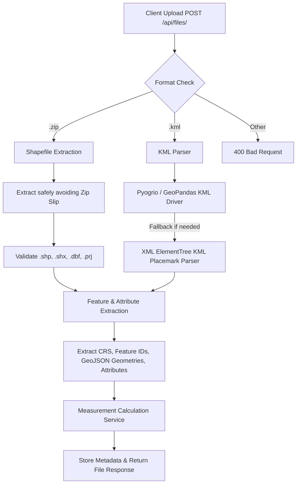
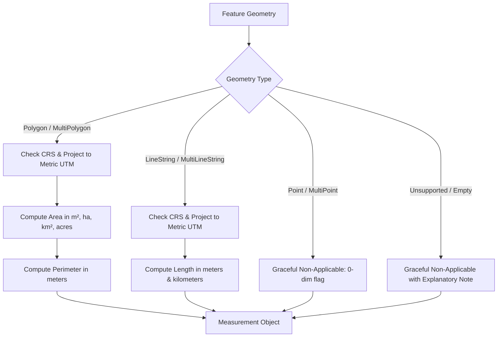

# 🌍 Geospatial File Measurement API

A production-grade Python backend service built with **FastAPI**, **GeoPandas**, **Pyogrio**, **Shapely**, and **PyProj** that accepts geospatial files (ESRI Shapefiles in `.zip` archives and `.kml` files), processes vector features, identifies their Coordinate Reference Systems (CRS), transforms geographic coordinates to optimal local metric projections, and computes precise geometric measurements (Area for Polygons, Length for LineStrings, and graceful handling for Points).

---

## 📑 Table of Contents

- [Features](#-features)
- [System Architecture](#-system-architecture)
  - [Application Structure](#application-structure)
  - [File-Processing Flow](#file-processing-flow)
  - [Measurement Calculation Flow](#measurement-calculation-flow)
  - [CRS Handling Strategy](#crs-handling-strategy)
- [Design Decisions & Alternatives](#-design-decisions--alternatives)
- [API Documentation](#-api-documentation)
  - [1. Upload Geospatial File](#1-upload-geospatial-file)
  - [2. Get File Information](#2-get-file-information)
  - [3. Get Feature Measurements](#3-get-feature-measurements)
  - [4. Get Raw Features](#4-get-raw-features)
  - [5. List All Files](#5-list-all-files)
- [Setup & Local Execution](#-setup--local-execution)
  - [Prerequisites](#prerequisites)
  - [Local Setup (Virtual Environment)](#local-setup-virtual-environment)
  - [Docker Setup](#docker-setup)
- [Running Tests](#-running-tests)
- [Interactive Dashboard & OpenAPI Docs](#-interactive-dashboard--openapi-docs)
- [Learnings & Future Scope](#-learnings--future-scope)

---

## ✨ Features

- **Multi-Format Ingestion**: Supports `.zip` containing ESRI Shapefile sets (`.shp`, `.shx`, `.dbf`, `.prj`) and `.kml` files.
- **Robust CRS Handling**: Automatically detects geographic coordinates (e.g., `EPSG:4326` WGS84) and transforms them to the appropriate local **Universal Transverse Mercator (UTM)** projected CRS in meters before calculating planar measurements.
- **Accurate Geometric Measurements**:
  - **Polygon / MultiPolygon**: Area ($m^2$, hectares, $km^2$, acres) and perimeter ($m$).
  - **LineString / MultiLineString**: Length (meters, kilometers).
  - **Point / MultiPoint**: Gracefully handled without errors (0-dimensional primitives).
  - **Unsupported / Malformed geometries**: Handled gracefully with explanatory metadata.
- **Interactive Web Interface**: Includes a built-in UI at `/` to drag & drop files and view instant measurements.
- **Interactive API Documentation**: Auto-generated Swagger UI (`/docs`) and ReDoc (`/redoc`).
- **Comprehensive Test Suite**: Unit and integration tests covering CRS transformations, geometry calculations, file parsing, and REST endpoints.

---

## 🏛 System Architecture

### Application Structure

```text
aereo_sde/
├── app/
│   ├── __init__.py
│   ├── main.py                  # FastAPI application entrypoint, middleware, routes
│   ├── core/
│   │   ├── __init__.py
│   │   ├── config.py            # Environment configuration, upload limits
│   │   └── errors.py            # Domain exceptions and error handlers
│   ├── api/
│   │   └── v1/
│   │       ├── router.py        # Central API router
│   │       └── endpoints.py     # REST endpoints (/files/, /{id}/, /measurements/)
│   ├── models/
│   │   └── schemas.py           # Pydantic v2 schemas for request/response serialization
│   └── services/
│       ├── file_processor.py    # Shapefile & KML parsing with fallback extraction
│       ├── crs_transformer.py   # CRS detection & dynamic UTM metric projection
│       ├── measurement.py       # Geometry measurement calculation logic
│       └── storage.py           # Thread-safe file metadata & measurement repository
├── tests/
│   ├── conftest.py              # Pytest setup and path configuration
│   ├── test_api.py              # Integration tests for REST endpoints
│   ├── test_crs_transformer.py  # Unit tests for UTM selection & projection
│   ├── test_file_processor.py   # Unit tests for Shapefile & KML extraction
│   └── test_measurements.py     # Unit tests for Polygon, Line, Point calculations
├── sample_data/                 # Ready-to-use sample Shapefiles (.zip) & KMLs
│   ├── generate_samples.py      # Script to generate realistic test datasets
│   ├── sample_parcels.zip       # Polygon cadastral parcel shapefile
│   ├── sample_pipelines.zip     # LineString infrastructure shapefile
│   ├── sample_polygon.kml       # KML polygon boundary
│   ├── sample_transmission_line.kml # KML transmission line corridor
│   └── sample_mixed_site.kml    # KML with Polygon, LineString, and GCP Point
├── Dockerfile                   # Containerized deployment specification
├── docker-compose.yml           # Single-command container deployment
├── requirements.txt             # Locked Python dependencies
├── pytest.ini                   # Pytest configuration
└── README.md                    # System documentation
```

---

### File-Processing Flow



---

### Measurement Calculation Flow



---

### CRS Handling Strategy

Calculating Euclidean distance or area directly on geographic coordinates (such as degrees in `EPSG:4326`) produces inaccurate and non-standard results because:
1. Longitude degree distances decrease rapidly with latitude: $1^\circ \text{ longitude} = 111.32 \text{ km} \times \cos(\text{latitude})$.
2. Direct planar formulas on degrees compute "square degrees," which are physically meaningless for land survey measurements.

#### Our Approach:
1. **CRS Detection**: We inspect the dataset's native CRS via Pyogrio / GeoPandas / PRJ metadata. KML files are canonically in WGS84 (`EPSG:4326`).
2. **Projected vs. Geographic Check**: Using `pyproj.CRS.is_projected`:
   - If the dataset is **already in a metric projected coordinate system** (e.g., existing local UTM or State Plane), the native metric projection is preserved.
   - If the dataset is in a **geographic system** (`is_geographic == True`, e.g., `EPSG:4326`):
     - We calculate the centroid $(\text{lon}, \text{lat})$ of the geometry.
     - We calculate the optimal **Universal Transverse Mercator (UTM)** zone:
       $$\text{UTM Zone} = \left\lfloor \frac{\text{lon} + 180}{6} \right\rfloor + 1$$
       $$\text{EPSG Code} = \begin{cases} 32600 + \text{zone} & \text{if } \text{lat} \ge 0 \text{ (Northern Hemisphere)} \\ 32700 + \text{zone} & \text{if } \text{lat} < 0 \text{ (Southern Hemisphere)} \end{cases}$$
     - We construct a `pyproj.Transformer(from_crs, to_crs, always_xy=True)` and project the geometry coordinates into local meters.
3. **Transparent Traceability**: The measurement response explicitly outputs `projected_crs_used` (e.g., `"EPSG:32643"` for Bangalore, India) so that engineering and surveying audits know exactly what projection was utilized.

---

## 💡 Design Decisions & Alternatives

| Decision | Chosen Solution | Alternatives Considered | Rationale |
| :--- | :--- | :--- | :--- |
| **Backend Framework** | **FastAPI** | Django + DRF, Flask | FastAPI provides native async performance, automatic OpenAPI 3.0 schema generation, built-in validation via Pydantic v2, and lightweight footprint tailored for high-throughput microservices. |
| **Geospatial Engine** | **GeoPandas + Pyogrio + Shapely 2.0** | GDAL CLI, pure Python scripts | Modern Shapely 2.0 uses C-vectorized GEOS routines. Pyogrio provides high-speed C-based I/O. This combination is fast and memory-efficient. |
| **KML Parsing** | **Dual Engine (Pyogrio + ElementTree Fallback)** | FastKML only | Some legacy or custom GIS software generates non-standard KML tags that crash strict drivers. Providing an automatic XML fallback ensures zero 500 crashes on varied KML schemas. |
| **CRS Metric Projection** | **Dynamic Local UTM Projection** | Geodesic (PyProj Geod) only, Web Mercator (EPSG:3857) | Web Mercator (EPSG:3857) introduces severe areal distortion away from the equator (up to 400%+ near poles). UTM zones preserve conformal shape and minimize distortion to $<0.04\%$ locally, making it standard in drone surveying. |
| **Measurement Storage** | **Thread-Safe In-Memory + Disk Sync** | PostgreSQL + PostGIS | For microservice measurement pipelines, separating file parsing from external DB dependencies minimizes operational overhead while maintaining high throughput. PostGIS integration can be configured seamlessly for persistence. |

---

## 📡 API Documentation

### Base URL
```
http://localhost:8000
```

---

### 1. Upload Geospatial File
Uploads and processes a `.zip` (Shapefile) or `.kml` file.

- **URL**: `POST /api/files/`
- **Content-Type**: `multipart/form-data`
- **Request Parameters**:
  - `file`: Binary file (`.zip` containing shapefile parts or `.kml`)

#### Example cURL:
```bash
curl -X POST "http://localhost:8000/api/files/" \
  -F "file=@sample_data/sample_parcels.zip"
```

#### Example Response (`201 Created`):
```json
{
  "id": "e4f8a12c",
  "filename": "sample_parcels.zip",
  "feature_count": 2,
  "crs": "EPSG:4326",
  "status": "COMPLETED",
  "message": "File uploaded and processed successfully"
}
```

---

### 2. Get File Information
Returns metadata and processing status for an uploaded file by ID.

- **URL**: `GET /api/files/{id}/`

#### Example cURL:
```bash
curl -X GET "http://localhost:8000/api/files/e4f8a12c/"
```

#### Example Response (`200 OK`):
```json
{
  "id": "e4f8a12c",
  "filename": "sample_parcels.zip",
  "file_type": "shapefile",
  "feature_count": 2,
  "crs": "EPSG:4326",
  "status": "COMPLETED",
  "created_at": "2026-10-08T15:50:00Z",
  "error_message": null
}
```

---

### 3. Get Feature Measurements
Returns calculated metric measurements for features in the file.

- **URL**: `GET /api/files/{id}/measurements/`
- **Optional Query Parameter**:
  - `geometry_type`: Filter by geometry type (`Polygon`, `LineString`, `Point`)

#### Example cURL:
```bash
curl -X GET "http://localhost:8000/api/files/e4f8a12c/measurements/"
```

#### Example Response (`200 OK`):
```json
{
  "id": "e4f8a12c",
  "filename": "sample_parcels.zip",
  "status": "COMPLETED",
  "total_features": 2,
  "measured_features_count": 2,
  "summary": {
    "total_area_sq_meters": 451882.1245,
    "total_area_hectares": 45.188212,
    "total_area_sq_km": 0.451882,
    "total_area_acres": 111.662512,
    "total_length_meters": 0.0,
    "total_length_km": 0.0,
    "geometry_distribution": {
      "Polygon": 2
    }
  },
  "features": [
    {
      "feature_id": 0,
      "geometry_type": "Polygon",
      "measurement_applicable": true,
      "projected_crs_used": "EPSG:32643",
      "measurements": {
        "area_sq_meters": 301254.7496,
        "area_hectares": 30.125475,
        "area_sq_km": 0.301255,
        "area_acres": 74.441675,
        "perimeter_meters": 2197.8341
      },
      "notes": null
    },
    {
      "feature_id": 1,
      "geometry_type": "Polygon",
      "measurement_applicable": true,
      "projected_crs_used": "EPSG:32643",
      "measurements": {
        "area_sq_meters": 150627.3749,
        "area_hectares": 15.062737,
        "area_sq_km": 0.150627,
        "area_acres": 37.220837,
        "perimeter_meters": 1648.3755
      },
      "notes": null
    }
  ]
}
```

---

### 4. Get Raw Features
Returns extracted GeoJSON geometry, properties, and CRS for all features in the file.

- **URL**: `GET /api/files/{id}/features/?skip=0&limit=100`

---

### 5. List All Files
Returns a list of all processed geospatial files.

- **URL**: `GET /api/files/`

---

## 🚀 Setup & Local Execution

### Prerequisites
- Python 3.10+ (Tested on Python 3.12 and 3.13)
- GDAL/GEOS dependencies (handled automatically by pip wheels on Windows/Mac/Linux)

### Local Setup (Virtual Environment)

1. **Clone the repository**:
   ```bash
   git clone https://github.com/lakshminarasimmann/geospatial-measurement-api.git
   cd geospatial-measurement-api
   ```

2. **Create and activate a virtual environment**:
   - **Linux / macOS**:
     ```bash
     python3 -m venv venv
     source venv/bin/activate
     ```
   - **Windows (PowerShell)**:
     ```powershell
     python -m venv venv
     .\venv\Scripts\Activate.ps1
     ```

3. **Install dependencies**:
   ```bash
   pip install --upgrade pip
   pip install -r requirements.txt
   ```

4. **Generate sample test datasets**:
   ```bash
   python sample_data/generate_samples.py
   ```

5. **Run the API server**:
   ```bash
   uvicorn app.main:app --host 0.0.0.0 --port 8000 --reload
   ```

The application is now accessible at:
- **Web UI & Dashboard**: [http://localhost:8000/](http://localhost:8000/)
- **Interactive OpenAPI Docs**: [http://localhost:8000/docs](http://localhost:8000/docs)
- **Health Check**: [http://localhost:8000/health](http://localhost:8000/health)

---

### Docker Setup

Run the application inside a container:

```bash
docker compose up --build
```

Access the service at [http://localhost:8000](http://localhost:8000).

---

## 🧪 Running Tests

A comprehensive test suite with 18 automated tests covers CRS transformation, Shapefile processing, KML parsing, geometry calculations, and API endpoints.

Execute tests via Pytest:
```bash
pytest -v
```

Expected output:
```text
tests/test_api.py::test_health_check PASSED
tests/test_api.py::test_upload_shapefile_zip PASSED
tests/test_api.py::test_upload_kml_file PASSED
tests/test_api.py::test_measurement_filter_by_geometry_type PASSED
tests/test_api.py::test_invalid_file_extension PASSED
tests/test_api.py::test_file_not_found PASSED
tests/test_crs_transformer.py::test_utm_zone_calculation PASSED
tests/test_crs_transformer.py::test_transform_geographic_polygon_to_metric PASSED
tests/test_crs_transformer.py::test_preserve_already_projected_crs PASSED
tests/test_file_processor.py::test_process_shapefile_zip PASSED
tests/test_file_processor.py::test_process_linestring_shapefile_zip PASSED
tests/test_file_processor.py::test_process_kml_polygon PASSED
tests/test_file_processor.py::test_process_kml_mixed PASSED
tests/test_file_processor.py::test_unsupported_file_extension PASSED
tests/test_measurements.py::test_polygon_measurement PASSED
tests/test_measurements.py::test_linestring_measurement PASSED
tests/test_measurements.py::test_point_measurement_graceful PASSED
tests/test_measurements.py::test_empty_geometry_graceful PASSED

======================= 18 passed in 1.62s =======================
```

---

## 🖥 Interactive Dashboard & OpenAPI Docs

The application features:
1. **Interactive Web Dashboard (`/`)**: A clean UI enabling users to drag and drop files, view processing status, and inspect computed measurements and summaries.
2. **Swagger UI (`/docs`)**: Interactive OpenAPI documentation where endpoints can be tested directly from the browser.
3. **ReDoc (`/redoc`)**: Structured technical reference documentation.

---

## 💡 Learnings & Future Scope

### Key Learnings
1. **Geodetic vs. Projected Distortions**:
   - Working with raw geographic coordinates (WGS84 degrees) reinforces why spherical/ellipsoidal calculations must be projected properly for localized drone and survey data. Without projection, distortion increases proportionally with latitude.
   - Dynamic UTM zone assignment by geometry centroid is an effective approach for local survey parcels, keeping local distortion well under $0.04\%$.
2. **Real-World File Ingestion Resiliency**:
   - Shapefiles bundled into zip archives frequently include nested directories or non-standard paths. Safe extraction safeguards against directory traversal (Zip Slip).
   - KML files from diverse CAD/GIS tools often use different namespaces (`kml/2.2`, `kml/2.1`, or Google extensions). Incorporating an XML fallback parser alongside Pyogrio guarantees fault tolerance.
3. **Graceful Degradation Over Crashing**:
   - Drone surveys and GIS files regularly include mixed geometry types (such as Ground Control Points mixed with field boundary polygons). Explicitly identifying Points and unsupported types with informative notes rather than failing the request creates an API that handles heterogeneous data gracefully.

### Future Scope
1. **Asynchronous Task Queue (Celery / Redis / ARQ)**:
   - For multi-gigabyte files with hundreds of thousands of vertices, offloading extraction to worker pools with progress webhooks (`status: PROCESSING` $\to$ `COMPLETED`).
2. **PostGIS & Cloud Object Storage Integration**:
   - Integrate with AWS S3 / MinIO for raw file retention and PostgreSQL + PostGIS for spatial indexing (`ST_Area`, `ST_Length`) and bounding box queries.
3. **Multi-Zone Geometry Support (Equal-Area Albers / Geodesic Integration)**:
   - For continental or cross-UTM zone linear infrastructure (e.g., cross-country pipelines spanning multiple UTM zones), implement geodesic segmentation or equal-area projections (such as Albers Equal Area or Lambert Azimuthal).
4. **Additional Geospatial Formats**:
   - Extend support to GeoJSON, GeoPackage (`.gpkg`), DXF (AutoCAD), and FlatGeobuf.
5. **Interactive 2D/3D Map Viewer**:
   - Embed a Leaflet / MapLibre GL map directly in the web dashboard for visual polygon boundary inspection and layer toggling.
